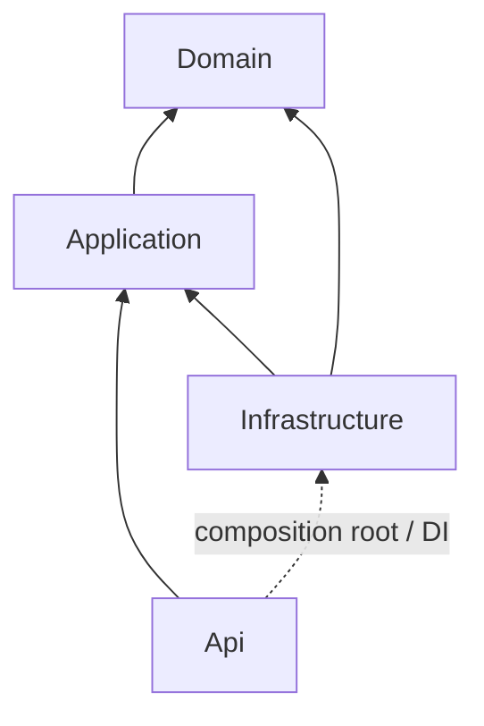

# Onion architecture / Архитектура Onion / Архітектура Onion

## English

Current correction: **1.1.0.3 OnionArchitecture**. Four backend projects enforce inward
code dependencies. Domain and Application form the application core; neither depends
on EF, ASP.NET, PostgreSQL or Infrastructure. See the dependency diagram below.

- **Domain/Entities**: entities, identity and content invariants, consistent author/comment
  relationships and read-only collections. No external project/package dependencies.
- **Application/Abstractions/Persistence**: application-owned persistence ports.
  ICommentRepository stages a comment and retrieves one by ID; IUnitOfWork persists
  staged changes in one scope. Contracts expose domain/.NET types, not DbContext,
  DbSet, IQueryable, SQL or HttpContext. Application references Domain only.
- **Infrastructure/Persistence**: CommentsDbContext, design-time factory, Configurations,
  Repositories and **Migrations**. CommentRepository implements the application port.
  The unit of work and repositories resolve the same scoped DbContext, so an author
  and comment can be saved atomically. Infrastructure references Application and Domain.
- **Infrastructure/Health**: an IHealthCheck adapter implements operational database
  readiness. Migration/status administration contracts remain in Infrastructure/Abstractions;
  they are technical operations, not business use cases in Application.
- **Api/Endpoints**: HTTP mapping and responses. System endpoints use the standard Health
  Checks mechanism. Program.cs is the composition root: it calls AddInfrastructure and
  dispatches explicit maintenance commands. Its Infrastructure reference is confined to
  composition/maintenance; request endpoints do not depend on Infrastructure or Domain.
  The EF Design package is private tooling for the startup project.

This correction establishes the core ports and their working adapters. Create/read
comment use cases, request/result models and their HTTP endpoints are scheduled for
**1.1.0.4 CommentsApi**; comment HTTP routes still return 404. Application will own
those scenarios and input validation; domain invariants remain in Domain. No MediatR,
CQRS framework or generic repository is required by this architecture.

SRP separates business invariants, scenarios, persistence and transport. Configuration
classes extend mappings without putting provider details in the core. DI supplies
implementations of application-owned interfaces (DIP); repository and save contracts
are separate (ISP). Implementations must preserve contract semantics (LSP).

Migration `20261029195935_InitialDataModel` is now in
`Infrastructure/Persistence/Migrations`. Its ID, generated SQL, history schema and
physical tables remain unchanged; only its namespace/location changes. No new
migration, database reset or checkpoint rotation is needed. For future schema changes,
use EF's `--output-dir Persistence/Migrations` with Infrastructure as target and Api
as startup project. Existing schema/export/Workbench projection remain applicable.

```bash
dotnet build CommentsService.slnx -c Release
dotnet test tests/CommentsService.Domain.Tests -c Release
python3 scripts/test-data-model.py
dotnet ef migrations has-pending-model-changes --project src/CommentsService.Infrastructure --startup-project src/CommentsService.Api
```

Domain.Tests includes core/architecture tests: allowed project references, independent
Domain/Application assemblies, provider-free application signatures and endpoint boundaries.
Data.Tests uses real PostgreSQL and per-test rollback, including DI scope/repository/save
integration. Private PG variables are required for EF commands; see database/MIGRATIONS.md.
Regression verification compares generated SQL, live schema/history and retained related
records across deployment, and checks fresh installation and database health failures.

## Русский

Текущее исправление: **1.1.0.3 OnionArchitecture**. Четыре проекта backend закрепляют
зависимости кода внутрь. Domain и Application образуют ядро приложения; ни один из них
не зависит от EF, ASP.NET, PostgreSQL и Infrastructure. Схема зависимостей приведена ниже.

- **Domain/Entities**: сущности, инварианты имени и содержимого, согласованные связи
  автора/комментария, коллекции только для чтения. Нет внешних ссылок на проекты/пакеты.
- **Application/Abstractions/Persistence**: контракты хранения, принадлежащие приложению.
  ICommentRepository ставит комментарий на сохранение и получает его по ID; IUnitOfWork
  сохраняет подготовленные изменения в одной области. Контракты используют типы Domain/.NET,
  без DbContext, DbSet, IQueryable, SQL и HttpContext. Application ссылается только на Domain.
- **Infrastructure/Persistence**: CommentsDbContext, фабрика времени разработки, Configurations,
  Repositories и **Migrations**. CommentRepository реализует прикладной контракт.
  Репозитории и единица работы используют один scoped DbContext: автора и комментарий
  можно сохранить атомарно. Infrastructure ссылается на Application и Domain.
- **Infrastructure/Health**: адаптер IHealthCheck проверяет техническую готовность БД.
  Контракты миграции/состояния БД остаются в Infrastructure/Abstractions: это технические
  операции, а не бизнес-сценарии Application.
- **Api/Endpoints**: HTTP и ответы. Системные endpoints используют стандартный механизм
  Health Checks. Program.cs — место сборки зависимостей: вызывает AddInfrastructure и
  выбирает явные служебные команды. Ссылка на Infrastructure используется при сборке/обслуживании;
  обработчики запросов не зависят от Infrastructure и Domain.
  Пакет EF Design приватный и нужен инструментам стартового проекта.

Исправление создаёт прикладные контракты и работающие адаптеры. Сценарии создания/чтения
комментариев, модели запросов/результатов и HTTP endpoints остаются в этапе
**1.1.0.4 CommentsApi**; HTTP-маршруты комментариев пока возвращают 404. Эти сценарии
и проверка входных данных будут в Application; доменные инварианты остаются в Domain.
MediatR, CQRS-фреймворк и универсальный репозиторий для этой архитектуры не обязательны.

SRP разделяет бизнес-инварианты, сценарии, хранение и транспорт. Классы конфигураций
расширяют настройки EF, не перенося детали провайдера в ядро. DI предоставляет
реализации прикладных интерфейсов (DIP); контракты репозитория и сохранения разделены
(ISP). Реализации должны сохранять семантику контрактов (LSP).

Миграция `20261029195935_InitialDataModel` теперь находится в
`Infrastructure/Persistence/Migrations`. ID, SQL, схема истории и физические таблицы
сохранены; меняются только пространство имён и расположение. Новая миграция, сброс БД
и замена контрольных копий не нужны. Для будущих изменений схемы используйте
`--output-dir Persistence/Migrations`, цель Infrastructure, стартовый проект Api.
Прежние схема/SQL-экспорт/проекция Workbench остаются актуальными.

```bash
dotnet build CommentsService.slnx -c Release
dotnet test tests/CommentsService.Domain.Tests -c Release
python3 scripts/test-data-model.py
dotnet ef migrations has-pending-model-changes --project src/CommentsService.Infrastructure --startup-project src/CommentsService.Api
```

Domain.Tests содержит доменные/архитектурные тесты: граф проектов, независимость сборок
Domain/Application, отсутствие типов провайдера в контрактах и границы endpoints.
Data.Tests использует PostgreSQL и откат каждого теста, включая проверку DI/репозитория/
сохранения. Для EF нужны приватные переменные PG; см. database/MIGRATIONS.md.
Проверки сравнивают SQL, реальную схему/историю и связанные записи после обновления,
а также проверяют установку с нуля и ошибки готовности БД.

## Українська

Поточне виправлення: **1.1.0.3 OnionArchitecture**. Чотири проєкти backend закріплюють
залежності коду всередину. Domain і Application утворюють ядро застосунку; жоден із них
не залежить від EF, ASP.NET, PostgreSQL та Infrastructure. Схему залежностей наведено нижче.

- **Domain/Entities**: сутності, інваріанти імені та вмісту, узгоджені зв’язки
  автора/коментаря, колекції лише для читання. Немає зовнішніх посилань на проєкти/пакети.
- **Application/Abstractions/Persistence**: контракти зберігання, що належать застосунку.
  ICommentRepository готує коментар до збереження та отримує його за ID; IUnitOfWork
  зберігає підготовлені зміни в одній області. Контракти використовують типи Domain/.NET,
  без DbContext, DbSet, IQueryable, SQL і HttpContext. Application посилається лише на Domain.
- **Infrastructure/Persistence**: CommentsDbContext, фабрика часу розробки, Configurations,
  Repositories та **Migrations**. CommentRepository реалізує прикладний контракт.
  Репозиторії та одиниця роботи використовують один scoped DbContext: автора й коментар
  можна зберегти атомарно. Infrastructure посилається на Application і Domain.
- **Infrastructure/Health**: адаптер IHealthCheck перевіряє технічну готовність БД.
  Контракти міграції/стану БД залишаються в Infrastructure/Abstractions: це технічні
  операції, а не бізнес-сценарії Application.
- **Api/Endpoints**: HTTP та відповіді. Системні endpoints використовують стандартний механізм
  Health Checks. Program.cs — місце складання залежностей: викликає AddInfrastructure та
  вибирає явні службові команди. Посилання на Infrastructure використовується під час складання/обслуговування;
  обробники запитів не залежать від Infrastructure та Domain.
  Пакет EF Design приватний і потрібний інструментам стартового проєкту.

Виправлення створює прикладні контракти й робочі адаптери. Сценарії створення/читання
коментарів, моделі запитів/результатів і HTTP endpoints залишаються в етапі
**1.1.0.4 CommentsApi**; HTTP-маршрути коментарів поки повертають 404. Ці сценарії
та перевірка вхідних даних будуть в Application; доменні інваріанти залишаються в Domain.
MediatR, CQRS-фреймворк та універсальний репозиторій для цієї архітектури не обов’язкові.

SRP розділяє бізнес-інваріанти, сценарії, зберігання й транспорт. Класи конфігурацій
розширюють налаштування EF, не переносячи деталі провайдера до ядра. DI надає
реалізації прикладних інтерфейсів (DIP); контракти репозиторію та збереження розділені
(ISP). Реалізації мають зберігати семантику контрактів (LSP).

Міграція `20261029195935_InitialDataModel` тепер розміщена в
`Infrastructure/Persistence/Migrations`. ID, SQL, схема історії та фізичні таблиці
збережені; змінюються лише простір імен і розташування. Нова міграція, скидання БД
та заміна контрольних копій не потрібні. Для майбутніх змін схеми використовуйте
`--output-dir Persistence/Migrations`, ціль Infrastructure, стартовий проєкт Api.
Попередні схема/SQL-експорт/проєкція Workbench залишаються актуальними.

```bash
dotnet build CommentsService.slnx -c Release
dotnet test tests/CommentsService.Domain.Tests -c Release
python3 scripts/test-data-model.py
dotnet ef migrations has-pending-model-changes --project src/CommentsService.Infrastructure --startup-project src/CommentsService.Api
```

Domain.Tests містить доменні/архітектурні тести: граф проєктів, незалежність збірок
Domain/Application, відсутність типів провайдера в контрактах і межі endpoints.
Data.Tests використовує PostgreSQL та відкат кожного тесту, включно з перевіркою DI/репозиторію/
збереження. Для EF потрібні приватні змінні PG; див. database/MIGRATIONS.md.
Перевірки порівнюють SQL, реальну схему/історію та пов’язані записи після оновлення,
а також перевіряють встановлення з нуля й помилки готовності БД.

## Dependencies / Зависимости / Залежності


