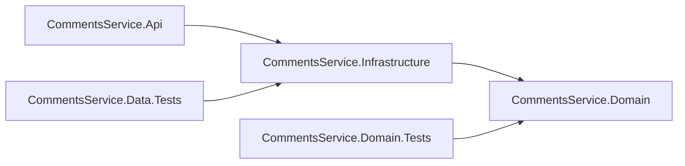

# Backend architecture / Архитектура backend / Архітектура backend

## English

Current release: **1.1.0.3 BackendLayers**. This correction supersedes the single-project
DataModel structure without changing the application version or database schema.

- **CommentsService.Domain**: plain .NET domain entities in `Entities`. No project/package
  dependencies, HTTP, EF attributes or database configuration. Constructors protect required
  values, storage bounds and identity rules; a comment maintains its author relationship.
  Author exposes a read-only comment collection. No public setters bypass these invariants.
- **CommentsService.Infrastructure**: EF Core/PostgreSQL implementation. `Persistence`
  contains CommentsDbContext and its design-time factory; `Persistence/Configurations`
  contains one IEntityTypeConfiguration per entity. `Migrations` contains the initial
  migration and snapshot. Infrastructure references Domain only.
- **CommentsService.Api**: HTTP endpoints, application bootstrap and command dispatch.
  `AddInfrastructure` registers implementations. Endpoints consume the small
  IDatabaseStatusReader contract; explicit migration commands use IDatabaseMigrator.
  Operational database contracts live in Infrastructure/Abstractions; Domain has no
  database-administration concepts. API has no persistence mappings or provider queries.
  Its EF Design package is private tooling for the EF startup project.
- **CommentsService.Domain.Tests**: independent unit tests for invariants, encapsulation,
  domain assembly independence and the allowed project dependency graph.
- **CommentsService.Data.Tests**: EF/PostgreSQL integration tests referencing Infrastructure
  directly, with per-test rollback. They do not depend on API hosting.

SRP separates entities, mappings, database operations and HTTP. New entity mappings can
be added without editing DbContext (OCP). Small read/migrate contracts can be substituted
through DI without changing endpoint logic (DIP/ISP); implementations keep the same
readiness contract, including the unconfigured-database case. No entity inheritance is
introduced solely for polymorphism; LSP must be preserved when extending contracts.
Business use cases and their ports must remain independent of concrete storage as
CommentsApi is developed. Additional abstractions should express actual behavior.

Migration `20261029195935_InitialDataModel` moves to Infrastructure with the same ID,
SQL, history schema and table names. CLR namespaces in its designer/snapshot are updated.
No replacement migration, schema reset or data conversion is needed. Existing checkpoints
are retained. EF commands now use Infrastructure as target and Api as startup project.

```bash
dotnet build CommentsService.slnx -c Release
dotnet test tests/CommentsService.Domain.Tests -c Release
python3 scripts/test-data-model.py
dotnet ef migrations has-pending-model-changes --project src/CommentsService.Infrastructure --startup-project src/CommentsService.Api
```

The last command requires private PG environment variables; see database/MIGRATIONS.md.
Regression checks compare generated SQL, live schema/history and retained rows across
the move, and check the container and native API behavior.

## Русский

Текущий выпуск: **1.1.0.3 BackendLayers**. Исправление заменяет структуру DataModel
с одним проектом, сохраняя версию приложения и схему БД.

- **CommentsService.Domain**: обычные .NET-сущности в `Entities`. Нет зависимостей
  от проектов/пакетов, HTTP, атрибутов EF и настроек БД. Конструкторы защищают обязательные
  значения, границы хранения и правила имени; комментарий поддерживает связь с автором.
  Коллекция комментариев автора доступна только для чтения. Публичных сеттеров для обхода правил нет.
- **CommentsService.Infrastructure**: реализация EF Core/PostgreSQL. В `Persistence`
  находятся CommentsDbContext и фабрика времени разработки; в `Persistence/Configurations`
  — отдельная IEntityTypeConfiguration для каждой сущности. В `Migrations` — первая
  миграция и снимок. Infrastructure ссылается только на Domain.
- **CommentsService.Api**: HTTP endpoints, запуск приложения и выбор команды.
  `AddInfrastructure` регистрирует реализации. Endpoints используют небольшой контракт
  IDatabaseStatusReader; явная команда миграции — IDatabaseMigrator.
  Операционные контракты БД находятся в Infrastructure/Abstractions; Domain не содержит
  понятий администрирования БД. В API нет настроек сущностей и запросов провайдера.
  Пакет EF Design приватный и нужен инструментам EF для стартового проекта.
- **CommentsService.Domain.Tests**: независимые unit-тесты инвариантов, инкапсуляции,
  отсутствия внешних зависимостей Domain и допустимого графа ссылок проектов.
- **CommentsService.Data.Tests**: интеграционные тесты EF/PostgreSQL с прямой ссылкой
  на Infrastructure и откатом каждого теста. От запуска API они не зависят.

SRP разделяет сущности, настройки EF, операции БД и HTTP. Новые настройки сущностей
добавляются без изменения DbContext (OCP). Небольшие контракты чтения/миграции заменяются
через DI без изменения endpoints (DIP/ISP); реализации сохраняют общий контракт
готовности, включая отсутствие настроенной БД. Наследование сущностей только ради
полиморфизма не вводится; при расширении контрактов необходимо соблюдать LSP.
При разработке CommentsApi бизнес-сценарии и их контракты должны оставаться независимыми
от конкретного хранения. Дополнительные абстракции должны выражать реальное поведение.

Миграция `20261029195935_InitialDataModel` перенесена в Infrastructure с прежними ID,
SQL, схемой истории и именами таблиц. CLR-пространства имён в designer/снимке обновлены.
Новая заменяющая миграция, сброс схемы и преобразование данных не нужны. Прежние
контрольные копии сохраняются. Цель EF-команд — Infrastructure, стартовый проект — Api.

```bash
dotnet build CommentsService.slnx -c Release
dotnet test tests/CommentsService.Domain.Tests -c Release
python3 scripts/test-data-model.py
dotnet ef migrations has-pending-model-changes --project src/CommentsService.Infrastructure --startup-project src/CommentsService.Api
```

Для последней команды нужны приватные переменные PG; см. database/MIGRATIONS.md.
Проверки сравнивают SQL, реальную схему/историю и сохранённые записи после переноса,
а также проверяют контейнер и самостоятельный запуск API.

## Українська

Поточний випуск: **1.1.0.3 BackendLayers**. Виправлення замінює структуру DataModel
з одним проєктом, зберігаючи версію застосунку та схему БД.

- **CommentsService.Domain**: звичайні .NET-сутності в `Entities`. Немає залежностей
  від проєктів/пакетів, HTTP, атрибутів EF та налаштувань БД. Конструктори захищають обов’язкові
  значення, межі зберігання та правила імені; коментар підтримує зв’язок з автором.
  Колекція коментарів автора доступна лише для читання. Публічних сетерів для обходу правил немає.
- **CommentsService.Infrastructure**: реалізація EF Core/PostgreSQL. У `Persistence`
  розміщені CommentsDbContext і фабрика часу розробки; у `Persistence/Configurations`
  — окрема IEntityTypeConfiguration для кожної сутності. У `Migrations` — перша
  міграція та знімок. Infrastructure посилається лише на Domain.
- **CommentsService.Api**: HTTP endpoints, запуск застосунку та вибір команди.
  `AddInfrastructure` реєструє реалізації. Endpoints використовують невеликий контракт
  IDatabaseStatusReader; явна команда міграції — IDatabaseMigrator.
  Операційні контракти БД розміщені в Infrastructure/Abstractions; Domain не містить
  понять адміністрування БД. В API немає налаштувань сутностей і запитів провайдера.
  Пакет EF Design приватний і потрібний інструментам EF для стартового проєкту.
- **CommentsService.Domain.Tests**: незалежні unit-тести інваріантів, інкапсуляції,
  відсутності зовнішніх залежностей Domain і дозволеного графа посилань проєктів.
- **CommentsService.Data.Tests**: інтеграційні тести EF/PostgreSQL з прямим посиланням
  на Infrastructure та відкатом кожного тесту. Від запуску API вони не залежать.

SRP розділяє сутності, налаштування EF, операції БД та HTTP. Нові налаштування сутностей
додаються без зміни DbContext (OCP). Невеликі контракти читання/міграції замінюються
через DI без зміни endpoints (DIP/ISP); реалізації зберігають спільний контракт
готовності, включно з відсутністю налаштованої БД. Успадкування сутностей лише заради
поліморфізму не вводиться; під час розширення контрактів слід дотримуватися LSP.
Під час розробки CommentsApi бізнес-сценарії та їхні контракти мають залишатися незалежними
від конкретного зберігання. Додаткові абстракції мають виражати реальну поведінку.

Міграцію `20261029195935_InitialDataModel` перенесено до Infrastructure з попередніми ID,
SQL, схемою історії та назвами таблиць. CLR-простори імен у designer/знімку оновлено.
Нова замінна міграція, скидання схеми та перетворення даних не потрібні. Попередні
контрольні копії зберігаються. Ціль EF-команд — Infrastructure, стартовий проєкт — Api.

```bash
dotnet build CommentsService.slnx -c Release
dotnet test tests/CommentsService.Domain.Tests -c Release
python3 scripts/test-data-model.py
dotnet ef migrations has-pending-model-changes --project src/CommentsService.Infrastructure --startup-project src/CommentsService.Api
```

Для останньої команди потрібні приватні змінні PG; див. database/MIGRATIONS.md.
Перевірки порівнюють SQL, реальну схему/історію та збережені записи після перенесення,
а також перевіряють контейнер і самостійний запуск API.

## Dependencies / Зависимости / Залежності


