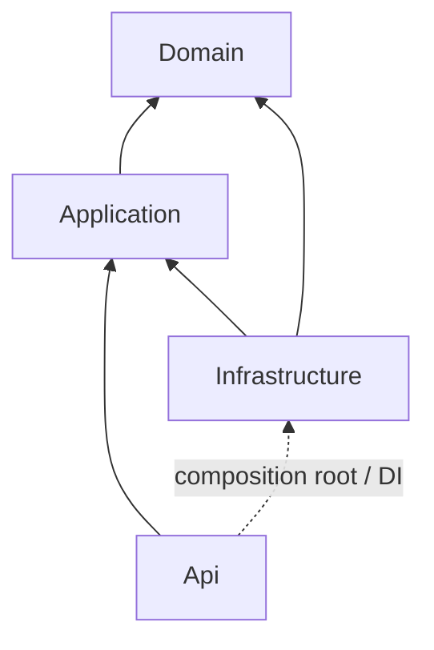

# Backend architecture / Архитектура backend / Архітектура backend

## English

Application owns ICommentMarkup/XhtmlCommentMarkup, shared by create and read-only preview. HTTP only maps transport. Frontend uses the CommentsClient port and an allowlisted React renderer, never raw HTML. No provider/HTTP dependency enters the core.

Release **1.1.0.6 XhtmlEditor** implements comment use cases inside the Onion core.

- Domain/Entities protects entity invariants and has no external project/package dependencies.
- Application/Comments contains CreateComment, GetComment and GetLatestComments, input validation,
  normalization, public DTOs and validation outcomes. Application references Domain only.
- Application/Abstractions/Persistence owns ICommentRepository, ICommentQueries and IUnitOfWork.
  These ports expose no EF/HTTP/provider types or IQueryable.
- Infrastructure implements tracked writes, no-tracking DTO projections and a scoped EfUnitOfWork.
  All write adapters share one DbContext. Only connectivity failures are translated into the
  core StorageUnavailableException; provider details stay outside HTTP responses.
- Infrastructure/Persistence contains DbContext, Configurations, Repositories, Queries and Migrations.
  Operational migration/status contracts and the standard IHealthCheck adapter remain technical concerns.
- Api/Endpoints maps HTTP to application inputs/results. Api/Contracts owns JSON transport rules;
  Api/Errors emits generic ProblemDetails. IP/User-Agent are read from server request context.
  Program.cs registers implementations; its Infrastructure reference is limited to composition/maintenance.

Validation occurs before staging writes. Author/comment are saved atomically by the shared
unit of work. Read queries project only public fields and bound the latest list; no network
metadata or entity navigation graph is serialized. See [API contract](API.md).

Tests are split into Domain.Tests (domain/architecture), Application.Tests (in-memory use cases),
Data.Tests (PostgreSQL with rollback), and Api.Tests (HTTP with cleanup of owned rows only).
Architecture tests guard inward references, core independence, public port types and endpoint boundaries.

Migration 20261029195935_InitialDataModel and SQL are unchanged from 1.1.0.3. No artificial
migration/checkpoint rotation is required. Future EF add commands use --output-dir Persistence/Migrations
with Infrastructure as target and Api as startup. XhtmlEditor is implemented; threads and full
sorting/pagination remain their planned milestones. OOP/SOLID/Onion apply to all subsequent changes.

## Русский

Application содержит ICommentMarkup/XhtmlCommentMarkup для создания и предпросмотра без записи. HTTP связывает транспорт. Frontend использует контракт CommentsClient и разрешённые React-элементы, без вставки HTML. Зависимости провайдера/HTTP не входят в ядро.

Выпуск **1.1.0.6 XhtmlEditor** реализует сценарии комментариев внутри ядра Onion.

- Domain/Entities защищает инварианты сущностей и не имеет внешних зависимостей от проектов/пакетов.
- Application/Comments содержит CreateComment, GetComment и GetLatestComments, валидацию ввода,
  нормализацию, публичные DTO и результаты валидации. Application ссылается только на Domain.
- Application/Abstractions/Persistence содержит ICommentRepository, ICommentQueries и IUnitOfWork.
  Контракты не раскрывают типы EF/HTTP/провайдера и IQueryable.
- Infrastructure реализует запись с отслеживанием, DTO-проекции без отслеживания и scoped EfUnitOfWork.
  Адаптеры записи используют один DbContext. Только ошибки доступности переводятся в
  StorageUnavailableException ядра; детали провайдера не выдаются в HTTP-ответах.
- Infrastructure/Persistence содержит DbContext, Configurations, Repositories, Queries и Migrations.
  Контракты миграции/состояния и стандартный адаптер IHealthCheck остаются техническими операциями.
- Api/Endpoints связывает HTTP с входами/результатами Application. Api/Contracts задаёт правила JSON;
  Api/Errors выдаёт общие ProblemDetails. IP/User-Agent берутся из серверного контекста запроса.
  Program.cs регистрирует реализации; ссылка на Infrastructure ограничена сборкой/обслуживанием.

Валидация выполняется до подготовки записи. Автор/комментарий сохраняются атомарно общей
единицей работы. Чтение проецирует только публичные поля и ограничивает список последних записей;
сетевые метаданные и граф сущностей не сериализуются. См. [контракт API](API.md).

Тесты разделены на Domain.Tests (домен/архитектура), Application.Tests (сценарии в памяти),
Data.Tests (PostgreSQL с откатом) и Api.Tests (HTTP с удалением только своих записей).
Архитектурные тесты контролируют ссылки внутрь, независимость ядра, типы контрактов и границы endpoints.

Миграция 20261029195935_InitialDataModel и SQL не меняются относительно 1.1.0.3. Искусственная
миграция/замена контрольных копий не нужна. При будущей генерации указывать --output-dir Persistence/Migrations,
цель Infrastructure, стартовый проект Api. XhtmlEditor реализован; ответы и полные
сортировки/пагинация остаются в своих этапах. OOP/SOLID/Onion обязательны при последующих изменениях.

## Українська

Application містить ICommentMarkup/XhtmlCommentMarkup для створення та перегляду без запису. HTTP пов’язує транспорт. Frontend використовує контракт CommentsClient і дозволені React-елементи, без вставлення HTML. Залежності провайдера/HTTP не входять до ядра.

Випуск **1.1.0.6 XhtmlEditor** реалізує сценарії коментарів усередині ядра Onion.

- Domain/Entities захищає інваріанти сутностей і не має зовнішніх залежностей від проєктів/пакетів.
- Application/Comments містить CreateComment, GetComment і GetLatestComments, валідацію вводу,
  нормалізацію, публічні DTO та результати валідації. Application посилається лише на Domain.
- Application/Abstractions/Persistence містить ICommentRepository, ICommentQueries та IUnitOfWork.
  Контракти не розкривають типи EF/HTTP/провайдера та IQueryable.
- Infrastructure реалізує запис із відстеженням, DTO-проєкції без відстеження та scoped EfUnitOfWork.
  Адаптери запису використовують один DbContext. Лише помилки доступності перетворюються на
  StorageUnavailableException ядра; деталі провайдера не надаються в HTTP-відповідях.
- Infrastructure/Persistence містить DbContext, Configurations, Repositories, Queries та Migrations.
  Контракти міграції/стану і стандартний адаптер IHealthCheck залишаються технічними операціями.
- Api/Endpoints пов’язує HTTP з входами/результатами Application. Api/Contracts задає правила JSON;
  Api/Errors надає загальні ProblemDetails. IP/User-Agent беруться із серверного контексту запиту.
  Program.cs реєструє реалізації; посилання на Infrastructure обмежене складанням/обслуговуванням.

Валідація виконується до підготовки запису. Автор/коментар зберігаються атомарно спільною
одиницею роботи. Читання проєктує лише публічні поля та обмежує список останніх записів;
мережеві метадані й граф сутностей не серіалізуються. Див. [контракт API](API.md).

Тести розділено на Domain.Tests (домен/архітектура), Application.Tests (сценарії в пам’яті),
Data.Tests (PostgreSQL із відкатом) та Api.Tests (HTTP з видаленням лише власних записів).
Архітектурні тести контролюють посилання всередину, незалежність ядра, типи контрактів і межі endpoints.

Міграція 20261029195935_InitialDataModel та SQL не змінюються відносно 1.1.0.3. Штучна
міграція/заміна контрольних копій не потрібна. Під час майбутньої генерації вказувати --output-dir Persistence/Migrations,
ціль Infrastructure, стартовий проєкт Api. XhtmlEditor реалізовано; відповіді й повні
сортування/пагінація залишаються у своїх етапах. OOP/SOLID/Onion обов’язкові під час наступних змін.

## Dependencies / Зависимости / Залежності

## Frontend boundaries / Границы frontend / Межі frontend

EN: React presentation uses the CommentsClient port. HttpCommentsClient implements HTTP;
the composition root injects it. Pure input validation and safe URL handling are separate
from rendering. Form state, request errors and the recent list have separate responsibilities.
Backend Domain/Application remain independent of React/HTTP/EF. Server validation is authoritative.

RU: React использует контракт CommentsClient. HttpCommentsClient реализует HTTP;
точка сборки внедряет его. Чистая валидация и безопасные URL отделены от отображения.
Состояние формы, ошибки запросов и список имеют отдельные обязанности.
Domain/Application не зависят от React/HTTP/EF. Серверная валидация окончательная.

UA: React використовує контракт CommentsClient. HttpCommentsClient реалізує HTTP;
точка складання впроваджує його. Чисту валідацію та безпечні URL відокремлено від відображення.
Стан форми, помилки запитів і список мають окремі обов’язки.
Domain/Application не залежать від React/HTTP/EF. Серверна валідація остаточна.
