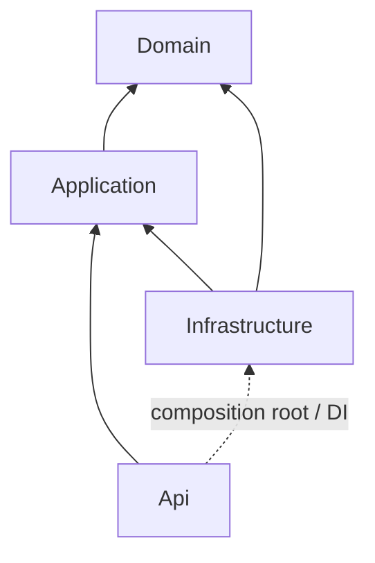

# Backend architecture / Архитектура backend / Архітектура backend

## English

TXT attachments (1.1.0.11): roots and replies accept one optional attachment: an image OR a `.txt` file. TXT must contain 1..102400 bytes (100 KiB), strict UTF-8; BOM, Unicode, CR/LF and tabs are preserved byte-for-byte. Invalid encoding and control characters other than CR/LF/tab are rejected; HTML/script text is accepted as literal text. Filename/MIME do not establish content validity. Multipart uses `textFile` with the usual comment/CAPTCHA fields; never send both file parts. JSON text-only creation remains available. Invalid TXT returns 400/errors.textFile. CAPTCHA is consumed before content processing; retry with a fresh code. The localized picker keeps draft/file on errors, clears on success and permits removing/replacing a selection.

DTOs add nullable `textFile: {id,fileName,sizeBytes}`; list/page/reply projections omit file bytes. `GET /api/text-files/{id}` downloads exact bytes as `text/plain; charset=utf-8`, generated UUID `.txt` filename, attachment disposition, nosniff, no-store and sandbox CSP; missing files return 404. HTML is never rendered. Full viewer/effects remain 1.1.0.12 FileViewer.

Upgrade 1.1.0.10 → 1.1.0.11: stop all writers, restore-verify a current checkpoint (include the benchmark when present), build, explicitly migrate every used database, then restart using the existing volumes. Migration `20261030130243_TextAttachments` adds TextAttachments: Id, unique CommentId FK CASCADE, sanitized FileName varchar128, SizeBytes, Data bytea; checks enforce 1..102400 bytes and matching size. Existing authors/comments/images and migration IDs are preserved. Down refuses while TXT rows exist. Bytes and comment are committed atomically in the same PostgreSQL database/backup; no filesystem volume. Preserve verified pre-upgrade copies, accounting for changes after their checkpoint.

Onion: Domain enforces immutable ownership/defensive bytes and one attachment per comment; Application defines processing/read ports and coordinates the transaction; Infrastructure validates UTF-8 and implements EF storage/queries; API binds streams and sets download headers. No new external dependency.

Validation: 235 backend tests (27 Domain,84 Application,56 Infrastructure/database,68 HTTP),16 frontend tests, frontend/Docker builds, restore upgrade/downgrade round trip and populated-TXT downgrade guard passed. Edge desktop/360px passed real CAPTCHA, TXT root/reply, boundary size, exact Unicode/BOM/CRLF/HTML download, restart persistence, safe headers, rejection/draft retention/removal, exclusive selection and EN/RU/UA without JavaScript errors. All 18 retained-million-corpus paging scenarios passed without reseeding; original row fingerprints, metadata, volumes and restore-verified checkpoints were retained. GUI import in VS/Workbench is not checked.

Domain ImageAttachment enforces one image/comment, bounded dimensions/bytes and defensive byte copies. Application owns ImageUpload/PreparedImage, IImageProcessor/IImageQueries and GetImage. CreateComment verifies CAPTCHA, processes the image before staging and saves the whole graph once. Infrastructure implements codec checks/orientation/resizing/PNG normalization, a two-slot decoder limit, EF bytea mapping and metadata-only comment projections. API owns multipart parsing/limits and inline image responses. No HTTP, EF or Skia dependency enters Domain/Application.

Application defines segregated ICaptchaIssuer/ICaptchaVerifier and challenge DTOs. CreateComment verifies before parent queries/staged writes. Infrastructure implements the bounded atomic hash store, TimeProvider expiry and a PNG-renderer abstraction. API maps challenge bytes to a data URL and no-store headers. Frontend useCaptcha owns refresh, cancellation, expiry and answer state; no persistence or HTTP types enter Domain/Application. Test-only DI doubles isolate legacy use-case suites; production contains no bypass.

GetRootPage validates page/sort/direction and exposes typed query contracts in Application. Infrastructure applies an allowlisted LINQ order, UUID tie-break, offset/25 limit, and repeatable-read count/items snapshot. The API only maps HTTP. Frontend RootPagination controls query state through CommentsClient; drafts and thread rendering remain separate. The compatibility latest-list use case is retained.

Application owns ICommentMarkup/XhtmlCommentMarkup, shared by create and read-only preview. HTTP only maps transport. Frontend uses the CommentsClient port and an allowlisted React renderer, never raw HTML. No provider/HTTP dependency enters the core.

Release **1.1.0.11 TextAttachments** implements comment use cases inside the Onion core.

- Domain/Entities protects entity invariants and has no external project/package dependencies.
- Application/Comments contains CreateComment, GetComment, GetReplies, GetRootPage and GetLatestComments, input validation,
  normalization, public DTOs and validation outcomes. Application references Domain only.
- Application/Abstractions/Persistence owns ICommentRepository, ICommentQueries and IUnitOfWork.
  These ports expose no EF/HTTP/provider types or IQueryable.
- Infrastructure implements tracked writes, no-tracking DTO projections and a scoped EfUnitOfWork.
  All write adapters share one DbContext. Only connectivity failures are translated into the
  core StorageUnavailableException; provider details stay outside HTTP responses.
- Infrastructure/Persistence contains DbContext, Configurations, Repositories, Queries and Migrations.
  Operational migration/status contracts and the standard IHealthCheck adapter remain technical concerns.
- Api/Endpoints maps HTTP to application inputs/results. Api/Contracts owns JSON transport rules;
  Api/Errors emits generic ProblemDetails. IP/User-Agent are read from server request context.
  Program.cs registers implementations; its Infrastructure reference is limited to composition/maintenance.

Validation occurs before staging writes. Author/comment are saved atomically by the shared
unit of work. Read queries project only public fields and bound the latest list; no network
metadata or entity navigation graph is serialized. See [API contract](API.md).

Tests are split into Domain.Tests (domain/architecture), Application.Tests (in-memory use cases),
Data.Tests (PostgreSQL with rollback), and Api.Tests (HTTP with cleanup of owned rows only).
Architecture tests guard inward references, core independence, public port types and endpoint boundaries.

Migration 20261030101720_CommentThreads extends the initial schema with immutable parent/root fields,
backfills old roots and preserves original content. Create validates the parent before staging an author;
GetReplies owns cursor/limit validation. Infrastructure implements bounded direct-child queries and projects
flat DTOs; no recursive EF navigation graphs are serialized. The UI flattens expanded branches iteratively.
Future EF add commands use --output-dir Persistence/Migrations. Root sorting/pagination is implemented in 1.1.0.8; OOP/SOLID/Onion remain mandatory. See database/MIGRATIONS.md for verified upgrade/rollback.

## Русский

TXT-вложения (1.1.0.11): корень и ответ принимают одно необязательное вложение: картинку ИЛИ `.txt`. TXT — 1..102400 байт (100 КиБ), строгий UTF-8; BOM, Unicode, CR/LF и табуляция сохраняются побайтно. Неверная кодировка и управляющие символы, кроме CR/LF/tab, отклоняются; HTML/script допускается как обычный текст. Имя/MIME не доказывают корректность содержимого. Multipart использует `textFile` с обычными полями комментария/CAPTCHA; два файла запрещены. JSON без файла сохранён. Неверный TXT: 400/errors.textFile. CAPTCHA расходуется перед проверкой содержимого; повтор требует нового кода. Локализованная форма сохраняет черновик/файл при ошибках, очищает после успеха, позволяет убрать/заменить файл.

DTO добавляет nullable `textFile: {id,fileName,sizeBytes}`; списки/страницы/ответы не содержат байты. `GET /api/text-files/{id}` скачивает точные байты с `text/plain; charset=utf-8`, UUID-именем `.txt`, attachment, nosniff, no-store и sandbox CSP; отсутствующий файл — 404. HTML не отображается. Полный просмотр/эффекты — 1.1.0.12 FileViewer.

Обновление 1.1.0.10 → 1.1.0.11: остановить все записи, проверить восстановление текущей копии (включая benchmark, если существует), собрать, явно мигрировать все используемые БД и запустить прежние тома. Миграция `20261030130243_TextAttachments` добавляет TextAttachments: Id, уникальный CommentId FK CASCADE, очищенное FileName varchar128, SizeBytes, Data bytea; проверки 1..102400 байт и совпадения размера. Авторы/комментарии/картинки и прежние ID миграций сохранены. Down запрещён при наличии TXT. Файл и комментарий записываются одной транзакцией в PostgreSQL и общую копию; файлового тома нет. Сохраните проверенные копии до обновления, учитывая изменения после контрольной точки.

Onion: Domain защищает принадлежность/байты и одно вложение; Application задаёт контракты обработки/чтения и транзакцию; Infrastructure проверяет UTF-8 и реализует EF; API связывает потоки и задаёт заголовки скачивания. Новых внешних зависимостей нет.

Проверки: 235 backend (27 Domain,84 Application,56 Infrastructure/БД,68 HTTP),16 frontend, сборки frontend/Docker, обновление/откат восстановленной копии и запрет отката с TXT прошли. Edge десктоп/360px прошёл реальную CAPTCHA, TXT корня/ответа, граничный размер, точные Unicode/BOM/CRLF/HTML-байты при скачивании и после перезапуска, заголовки, отказы/черновик/удаление, выбор одного файла и EN/RU/UA без ошибок JavaScript. Все 18 сценариев сохранённого миллиона прошли без пересоздания; отпечатки исходных строк, метаданные, тома и проверенные восстановлением копии сохранены. GUI VS/Workbench не проверены.

Domain ImageAttachment защищает одну картинку на комментарий, пределы размеров/байтов и копирование массива. Application задаёт ImageUpload/PreparedImage, IImageProcessor/IImageQueries и GetImage. CreateComment проверяет CAPTCHA, обрабатывает картинку до подготовки записи и сохраняет граф один раз. Infrastructure реализует кодек/поворот/уменьшение/PNG, два параллельных декодера, EF bytea и проекции только метаданных. API отвечает за multipart/лимиты и inline-выдачу. Domain/Application не зависят от HTTP, EF или Skia.

Application задаёт отдельные ICaptchaIssuer/ICaptchaVerifier и DTO проверки. CreateComment проверяет код до поиска родителя/подготовки записи. Infrastructure содержит ограниченное атомарное хранилище хешей, TimeProvider и абстракцию PNG-рендера. API выдаёт data URL и no-store. useCaptcha управляет обновлением, отменой, просрочкой и вводом; Domain/Application не получают зависимостей HTTP/хранения. Только тесты внедряют заглушки для остальных сценариев; в production обхода нет.

GetRootPage проверяет page/sort/direction и задаёт типизированный запрос в Application. Infrastructure применяет разрешённую LINQ-сортировку, UUID для равных значений, offset/25 и repeatable-read снимок количества/строк. API связывает HTTP. RootPagination управляет запросом через CommentsClient; черновик и ветки отделены. Прежний сценарий последнего списка сохранён.

Application содержит ICommentMarkup/XhtmlCommentMarkup для создания и предпросмотра без записи. HTTP связывает транспорт. Frontend использует контракт CommentsClient и разрешённые React-элементы, без вставки HTML. Зависимости провайдера/HTTP не входят в ядро.

Выпуск **1.1.0.11 TextAttachments** реализует сценарии комментариев внутри ядра Onion.

- Domain/Entities защищает инварианты сущностей и не имеет внешних зависимостей от проектов/пакетов.
- Application/Comments содержит CreateComment, GetComment, GetReplies, GetRootPage и GetLatestComments, валидацию ввода,
  нормализацию, публичные DTO и результаты валидации. Application ссылается только на Domain.
- Application/Abstractions/Persistence содержит ICommentRepository, ICommentQueries и IUnitOfWork.
  Контракты не раскрывают типы EF/HTTP/провайдера и IQueryable.
- Infrastructure реализует запись с отслеживанием, DTO-проекции без отслеживания и scoped EfUnitOfWork.
  Адаптеры записи используют один DbContext. Только ошибки доступности переводятся в
  StorageUnavailableException ядра; детали провайдера не выдаются в HTTP-ответах.
- Infrastructure/Persistence содержит DbContext, Configurations, Repositories, Queries и Migrations.
  Контракты миграции/состояния и стандартный адаптер IHealthCheck остаются техническими операциями.
- Api/Endpoints связывает HTTP с входами/результатами Application. Api/Contracts задаёт правила JSON;
  Api/Errors выдаёт общие ProblemDetails. IP/User-Agent берутся из серверного контекста запроса.
  Program.cs регистрирует реализации; ссылка на Infrastructure ограничена сборкой/обслуживанием.

Валидация выполняется до подготовки записи. Автор/комментарий сохраняются атомарно общей
единицей работы. Чтение проецирует только публичные поля и ограничивает список последних записей;
сетевые метаданные и граф сущностей не сериализуются. См. [контракт API](API.md).

Тесты разделены на Domain.Tests (домен/архитектура), Application.Tests (сценарии в памяти),
Data.Tests (PostgreSQL с откатом) и Api.Tests (HTTP с удалением только своих записей).
Архитектурные тесты контролируют ссылки внутрь, независимость ядра, типы контрактов и границы endpoints.

Миграция 20261030101720_CommentThreads расширяет схему неизменяемыми полями родителя/корня,
заполняет старые корни и сохраняет прежние данные. Create проверяет родителя до подготовки автора;
GetReplies проверяет курсор/лимит. Infrastructure выполняет ограниченные запросы прямых ответов и выдаёт
плоские DTO без рекурсивного графа EF. UI итеративно разворачивает открытые ветки.
При генерации EF указывать --output-dir Persistence/Migrations. Сортировки/страницы корней реализованы в 1.1.0.8; OOP/SOLID/Onion обязательны. Обновление/откат: database/MIGRATIONS.md.

## Українська

TXT-вкладення (1.1.0.11): корінь і відповідь приймають одне необов’язкове вкладення: зображення АБО `.txt`. TXT — 1..102400 байтів (100 КіБ), строгий UTF-8; BOM, Unicode, CR/LF і табуляція зберігаються побайтово. Хибне кодування та керівні символи, крім CR/LF/tab, відхиляються; HTML/script дозволено як звичайний текст. Назва/MIME не доводять коректність вмісту. Multipart використовує `textFile` зі звичайними полями коментаря/CAPTCHA; два файли заборонено. JSON без файла збережено. Хибний TXT: 400/errors.textFile. CAPTCHA витрачається до перевірки вмісту; повтор потребує нового коду. Локалізована форма зберігає чернетку/файл після помилок, очищає після успіху, дозволяє прибрати/замінити файл.

DTO додає nullable `textFile: {id,fileName,sizeBytes}`; списки/сторінки/відповіді не містять байтів. `GET /api/text-files/{id}` завантажує точні байти з `text/plain; charset=utf-8`, UUID-назвою `.txt`, attachment, nosniff, no-store та sandbox CSP; відсутній файл — 404. HTML не відображається. Повний перегляд/ефекти — 1.1.0.12 FileViewer.

Оновлення 1.1.0.10 → 1.1.0.11: зупинити всі записи, перевірити відновлення поточної копії (включно з benchmark, якщо існує), зібрати, явно мігрувати всі використані БД і запустити попередні томи. Міграція `20261030130243_TextAttachments` додає TextAttachments: Id, унікальний CommentId FK CASCADE, очищене FileName varchar128, SizeBytes, Data bytea; перевірки 1..102400 байтів і збігу розміру. Авторів/коментарі/зображення й попередні ID міграцій збережено. Down заборонено за наявності TXT. Файл і коментар записуються однією транзакцією в PostgreSQL і спільну копію; файлового тому немає. Збережіть перевірені копії до оновлення, враховуючи зміни після контрольної точки.

Onion: Domain захищає належність/байти й одне вкладення; Application задає контракти обробки/читання та транзакцію; Infrastructure перевіряє UTF-8 і реалізує EF; API зв’язує потоки та задає заголовки завантаження. Нових зовнішніх залежностей немає.

Перевірки: 235 backend (27 Domain,84 Application,56 Infrastructure/БД,68 HTTP),16 frontend, збирання frontend/Docker, оновлення/відкат відновленої копії та заборона відкату з TXT пройшли. Edge десктоп/360px пройшов реальну CAPTCHA, TXT кореня/відповіді, граничний розмір, точні Unicode/BOM/CRLF/HTML-байти під час завантаження й після перезапуску, заголовки, відмови/чернетку/видалення, вибір одного файла та EN/RU/UA без помилок JavaScript. Усі 18 сценаріїв збереженого мільйона пройшли без повторного створення; відбитки початкових рядків, метадані, томи та перевірені відновленням копії збережено. GUI VS/Workbench не перевірено.

Domain ImageAttachment захищає одне зображення на коментар, межі розмірів/байтів і копіювання масиву. Application задає ImageUpload/PreparedImage, IImageProcessor/IImageQueries та GetImage. CreateComment перевіряє CAPTCHA, обробляє зображення до підготовки запису та зберігає граф один раз. Infrastructure реалізує кодек/поворот/зменшення/PNG, два паралельні декодери, EF bytea та проєкції лише метаданих. API відповідає за multipart/ліміти й inline-видачу. Domain/Application не залежать від HTTP, EF чи Skia.

Application задає окремі ICaptchaIssuer/ICaptchaVerifier і DTO перевірки. CreateComment перевіряє код до пошуку батьківського запису/підготовки запису. Infrastructure містить обмежене атомарне сховище хешів, TimeProvider та абстракцію PNG-рендеру. API видає data URL і no-store. useCaptcha керує оновленням, скасуванням, простроченням та введенням; Domain/Application не отримують залежностей HTTP/сховища. Лише тести впроваджують заглушки для решти сценаріїв; у production обходу немає.

GetRootPage перевіряє page/sort/direction і задає типізований запит в Application. Infrastructure застосовує дозволене LINQ-сортування, UUID для однакових значень, offset/25 і repeatable-read знімок кількості/рядків. API пов’язує HTTP. RootPagination керує запитом через CommentsClient; чернетку й гілки відокремлено. Попередній сценарій останнього списку збережено.

Application містить ICommentMarkup/XhtmlCommentMarkup для створення та перегляду без запису. HTTP пов’язує транспорт. Frontend використовує контракт CommentsClient і дозволені React-елементи, без вставлення HTML. Залежності провайдера/HTTP не входять до ядра.

Випуск **1.1.0.11 TextAttachments** реалізує сценарії коментарів усередині ядра Onion.

- Domain/Entities захищає інваріанти сутностей і не має зовнішніх залежностей від проєктів/пакетів.
- Application/Comments містить CreateComment, GetComment, GetReplies, GetRootPage і GetLatestComments, валідацію вводу,
  нормалізацію, публічні DTO та результати валідації. Application посилається лише на Domain.
- Application/Abstractions/Persistence містить ICommentRepository, ICommentQueries та IUnitOfWork.
  Контракти не розкривають типи EF/HTTP/провайдера та IQueryable.
- Infrastructure реалізує запис із відстеженням, DTO-проєкції без відстеження та scoped EfUnitOfWork.
  Адаптери запису використовують один DbContext. Лише помилки доступності перетворюються на
  StorageUnavailableException ядра; деталі провайдера не надаються в HTTP-відповідях.
- Infrastructure/Persistence містить DbContext, Configurations, Repositories, Queries та Migrations.
  Контракти міграції/стану і стандартний адаптер IHealthCheck залишаються технічними операціями.
- Api/Endpoints пов’язує HTTP з входами/результатами Application. Api/Contracts задає правила JSON;
  Api/Errors надає загальні ProblemDetails. IP/User-Agent беруться із серверного контексту запиту.
  Program.cs реєструє реалізації; посилання на Infrastructure обмежене складанням/обслуговуванням.

Валідація виконується до підготовки запису. Автор/коментар зберігаються атомарно спільною
одиницею роботи. Читання проєктує лише публічні поля та обмежує список останніх записів;
мережеві метадані й граф сутностей не серіалізуються. Див. [контракт API](API.md).

Тести розділено на Domain.Tests (домен/архітектура), Application.Tests (сценарії в пам’яті),
Data.Tests (PostgreSQL із відкатом) та Api.Tests (HTTP з видаленням лише власних записів).
Архітектурні тести контролюють посилання всередину, незалежність ядра, типи контрактів і межі endpoints.

Міграція 20261030101720_CommentThreads розширює схему незмінними полями батьківського запису/кореня,
заповнює старі корені та зберігає попередні дані. Create перевіряє батьківський запис до підготовки автора;
GetReplies перевіряє курсор/ліміт. Infrastructure виконує обмежені запити прямих відповідей та видає
плоскі DTO без рекурсивного графа EF. UI ітеративно розгортає відкриті гілки.
Під час генерації EF вказувати --output-dir Persistence/Migrations. Сортування/сторінки коренів реалізовано в 1.1.0.8; OOP/SOLID/Onion обов’язкові. Оновлення/відкат: database/MIGRATIONS.md.

## Dependencies / Зависимости / Залежності

## Frontend boundaries / Границы frontend / Межі frontend

EN: React presentation uses the CommentsClient port. HttpCommentsClient implements HTTP;
the composition root injects it. Pure input validation and safe URL handling are separate
from rendering. Form state, request errors and the recent list have separate responsibilities.
Backend Domain/Application remain independent of React/HTTP/EF. Server validation is authoritative.

RU: React использует контракт CommentsClient. HttpCommentsClient реализует HTTP;
точка сборки внедряет его. Чистая валидация и безопасные URL отделены от отображения.
Состояние формы, ошибки запросов и список имеют отдельные обязанности.
Domain/Application не зависят от React/HTTP/EF. Серверная валидация окончательная.

UA: React використовує контракт CommentsClient. HttpCommentsClient реалізує HTTP;
точка складання впроваджує його. Чисту валідацію та безпечні URL відокремлено від відображення.
Стан форми, помилки запитів і список мають окремі обов’язки.
Domain/Application не залежать від React/HTTP/EF. Серверна валідація остаточна.
