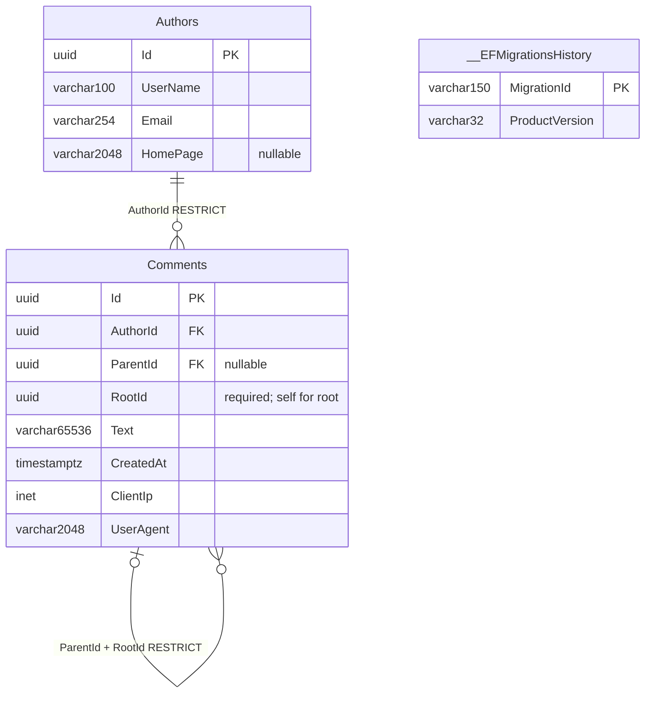
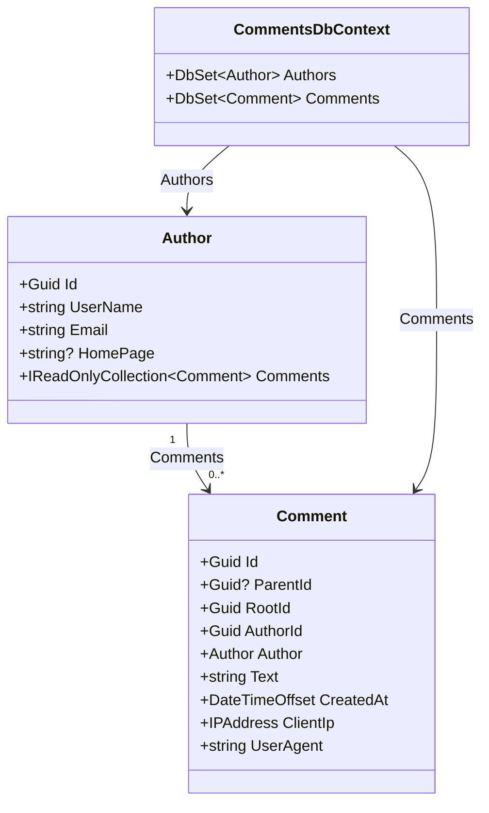

# Data model / Модель данных / Модель даних — 1.1.0.7

## English

Thread migration: `20261030101720_CommentThreads`. Existing roots have ParentId=NULL, RootId=Id. Composite (ParentId,RootId) → (Id,RootId) restricts deletion and rejects a different root than the parent. Domain constructors derive these immutable values; there is no reparent/edit API. Replies are indexed by (ParentId,CreatedAt,Id); (Id,RootId) is an alternate key.

Entities live in Domain/Entities; DbContext/configurations/migrations live in Infrastructure/Persistence.
Constructors enforce required values and storage bounds. See [architecture](../ARCHITECTURE.md).

The authoritative schema is PostgreSQL, generated by EF migration
`20261029195935_InitialDataModel` + `20261030101720_CommentThreads`; [postgresql.sql](postgresql.sql) is its idempotent
export. All application tables and EF history live in the `comments` schema.
The shared diagrams below describe the implemented database and OOP classes.

An Author is submitted identity metadata, not an authenticated account. Email is
not unique; matching addresses do not establish identity. A Comment references
one Author; deleting that Author is restricted while comments exist. UUIDs and
UTC timestamps are generated by the application. Homepage and ParentId are nullable; all other
fields are required. PostgreSQL stores IP addresses as `inet` (IPv4 and IPv6).

Limits: UserName 100, Email 254, HomePage 2048, Text 65536, UserAgent 2048 characters.
Database checks require a nonempty Latin-alphanumeric UserName and Text containing
something other than spaces. Email/URL syntax and text/XHTML validation are enforced by
CommentsApi; see [API rules](../API.md). These storage limits are application choices, not assignment limits.
Indexes: Comments.AuthorId and descending (CreatedAt, Id), in addition to primary keys.
ParentId/RootId implement immutable threads; attachments remain planned.

[workbench.sql](workbench.sql) is a MySQL visualization projection of this schema,
including migration history. Import it through **File → Import → Reverse Engineer
MySQL Create Script**, with UTF-8 and placement on a diagram enabled; then save as
`.mwb`. See the [official import instructions](https://dev.mysql.com/doc/workbench/en/wb-reverse-engineer-create-script.html).
The projection maps UUID to CHAR(36), inet to VARCHAR(45), UTC timestamptz to
DATETIME(6), and VARCHAR(65536) to annotated MEDIUMTEXT. PostgreSQL check constraints
remain authoritative in the migration/export. Never deploy the projection to PostgreSQL.
Import through the MySQL Workbench GUI has not been verified for this release.

## Русский

Миграция ответов: `20261030101720_CommentThreads`. Старые корни: ParentId=NULL, RootId=Id. Составной FK (ParentId,RootId) → (Id,RootId) запрещает удаление родителя и другой корень ответа. Конструктор Domain определяет неизменяемые связи; API изменения родителя/записи нет. Индекс ответов: (ParentId,CreatedAt,Id); альтернативный ключ (Id,RootId).

Сущности находятся в Domain/Entities, DbContext/конфигурации и миграции — в Infrastructure/Persistence.
Конструкторы защищают обязательные значения и пределы хранения. См. [архитектуру](../ARCHITECTURE.md).

Эталонная схема — PostgreSQL, созданная миграцией EF
`20261029195935_InitialDataModel` + `20261030101720_CommentThreads`; [postgresql.sql](postgresql.sql) — её идемпотентный
экспорт. Все таблицы приложения и история EF находятся в схеме `comments`.
Общие диаграммы ниже показывают реализованную БД и классы ООП.

Author — введённые данные автора, а не учётная запись. Email не уникален;
совпадение адресов не подтверждает личность. Comment ссылается на одного Author;
удаление автора запрещено, пока существуют его комментарии. UUID и время UTC
формируются приложением. Homepage и ParentId допускают NULL; остальные поля обязательны.
IP-адрес хранится как `inet` PostgreSQL с поддержкой IPv4 и IPv6.

Ограничения длины: UserName 100, Email 254, HomePage 2048, Text 65536, UserAgent 2048 символов.
БД требует непустое имя из латинских букв/цифр и текст, содержащий не только пробелы.
Формат Email/URL и текстовый ввод проверяются в CommentsApi; см. [правила API](../API.md). Эти пределы хранения —
решение приложения, а не ограничения задания. Индексы: Comments.AuthorId и
(CreatedAt, Id) по убыванию, дополнительно к первичным ключам.
ParentId/RootId реализуют неизменяемые ветки; вложения остаются в плане.

[workbench.sql](workbench.sql) — проекция схемы для визуализации MySQL, включая историю
миграций. Импорт: **File → Import → Reverse Engineer MySQL Create Script**, UTF-8,
размещение объектов на диаграмме; затем сохранить `.mwb`.
См. [официальную инструкцию импорта](https://dev.mysql.com/doc/workbench/en/wb-reverse-engineer-create-script.html).
UUID отображается в CHAR(36), inet — VARCHAR(45), UTC timestamptz — DATETIME(6),
VARCHAR(65536) — MEDIUMTEXT с пояснением. Проверочные ограничения PostgreSQL остаются
эталонными в миграции/экспорте. Проекция не предназначена для развёртывания в PostgreSQL.
Импорт через GUI MySQL Workbench в этой версии не проверен.

## Українська

Міграція відповідей: `20261030101720_CommentThreads`. Старі корені: ParentId=NULL, RootId=Id. Складений FK (ParentId,RootId) → (Id,RootId) забороняє видалення батьківського запису й інший корінь відповіді. Конструктор Domain визначає незмінні зв’язки; API зміни батьківського запису/редагування немає. Індекс відповідей: (ParentId,CreatedAt,Id); альтернативний ключ (Id,RootId).

Сутності розміщені в Domain/Entities, DbContext/конфігурації та міграції — в Infrastructure/Persistence.
Конструктори захищають обов’язкові значення та межі зберігання. Див. [архітектуру](../ARCHITECTURE.md).

Еталонна схема — PostgreSQL, створена міграцією EF
`20261029195935_InitialDataModel` + `20261030101720_CommentThreads`; [postgresql.sql](postgresql.sql) — її ідемпотентний
експорт. Усі таблиці застосунку та історія EF розміщені у схемі `comments`.
Спільні діаграми нижче показують реалізовану БД та класи ООП.

Author — введені дані автора, а не обліковий запис. Email не унікальний;
збіг адрес не підтверджує особу. Comment посилається на одного Author;
видалення автора заборонено, доки існують його коментарі. UUID і час UTC
формуються застосунком. Homepage і ParentId допускають NULL; решта полів обов’язкові.
IP-адреса зберігається як `inet` PostgreSQL із підтримкою IPv4 та IPv6.

Межі довжини: UserName 100, Email 254, HomePage 2048, Text 65536, UserAgent 2048 символів.
БД вимагає непорожнє ім’я з латинських літер/цифр і текст, що містить не лише пробіли.
Формат Email/URL і текстовий ввід перевіряються в CommentsApi; див. [правила API](../API.md). Ці межі зберігання —
рішення застосунку, а не обмеження завдання. Індекси: Comments.AuthorId та
(CreatedAt, Id) за спаданням, додатково до первинних ключів.
ParentId/RootId реалізують незмінні гілки; вкладення залишаються у плані.

[workbench.sql](workbench.sql) — проєкція схеми для візуалізації MySQL, включно з історією
міграцій. Імпорт: **File → Import → Reverse Engineer MySQL Create Script**, UTF-8,
розміщення об’єктів на діаграмі; потім зберегти `.mwb`.
Див. [офіційну інструкцію імпорту](https://dev.mysql.com/doc/workbench/en/wb-reverse-engineer-create-script.html).
UUID відображається в CHAR(36), inet — VARCHAR(45), UTC timestamptz — DATETIME(6),
VARCHAR(65536) — MEDIUMTEXT із поясненням. Перевірочні обмеження PostgreSQL залишаються
еталонними в міграції/експорті. Проєкція не призначена для розгортання в PostgreSQL.
Імпорт через GUI MySQL Workbench у цій версії не перевірено.

## ER / БД / БД

## OOP / ООП / ООП

