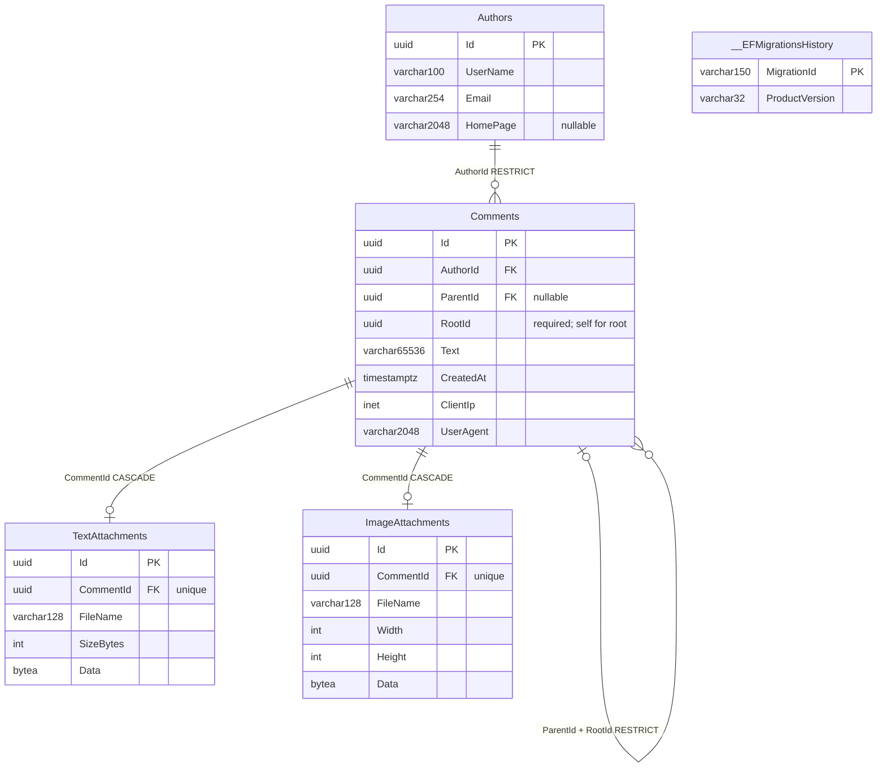
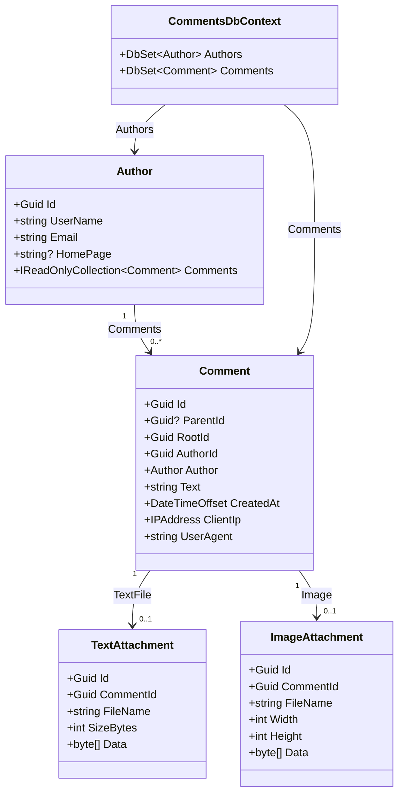

# Data model / Модель данных / Модель даних — 1.1.0.11

## English

TXT attachments (1.1.0.11): roots and replies accept one optional attachment: an image OR a `.txt` file. TXT must contain 1..102400 bytes (100 KiB), strict UTF-8; BOM, Unicode, CR/LF and tabs are preserved byte-for-byte. Invalid encoding and control characters other than CR/LF/tab are rejected; HTML/script text is accepted as literal text. Filename/MIME do not establish content validity. Multipart uses `textFile` with the usual comment/CAPTCHA fields; never send both file parts. JSON text-only creation remains available. Invalid TXT returns 400/errors.textFile. CAPTCHA is consumed before content processing; retry with a fresh code. The localized picker keeps draft/file on errors, clears on success and permits removing/replacing a selection.

DTOs add nullable `textFile: {id,fileName,sizeBytes}`; list/page/reply projections omit file bytes. `GET /api/text-files/{id}` downloads exact bytes as `text/plain; charset=utf-8`, generated UUID `.txt` filename, attachment disposition, nosniff, no-store and sandbox CSP; missing files return 404. HTML is never rendered. Full viewer/effects remain 1.1.0.12 FileViewer.

Upgrade 1.1.0.10 → 1.1.0.11: stop all writers, restore-verify a current checkpoint (include the benchmark when present), build, explicitly migrate every used database, then restart using the existing volumes. Migration `20261030130243_TextAttachments` adds TextAttachments: Id, unique CommentId FK CASCADE, sanitized FileName varchar128, SizeBytes, Data bytea; checks enforce 1..102400 bytes and matching size. Existing authors/comments/images and migration IDs are preserved. Down refuses while TXT rows exist. Bytes and comment are committed atomically in the same PostgreSQL database/backup; no filesystem volume. Preserve verified pre-upgrade copies, accounting for changes after their checkpoint.

Onion: Domain enforces immutable ownership/defensive bytes and one attachment per comment; Application defines processing/read ports and coordinates the transaction; Infrastructure validates UTF-8 and implements EF storage/queries; API binds streams and sets download headers. No new external dependency.

Validation: 235 backend tests (27 Domain,84 Application,56 Infrastructure/database,68 HTTP),16 frontend tests, frontend/Docker builds, restore upgrade/downgrade round trip and populated-TXT downgrade guard passed. Edge desktop/360px passed real CAPTCHA, TXT root/reply, boundary size, exact Unicode/BOM/CRLF/HTML download, restart persistence, safe headers, rejection/draft retention/removal, exclusive selection and EN/RU/UA without JavaScript errors. All 18 retained-million-corpus paging scenarios passed without reseeding; original row fingerprints, metadata, volumes and restore-verified checkpoints were retained. GUI import in VS/Workbench is not checked.

Image migration `20261030122207_ImageAttachments` adds ImageAttachments (Id, unique CommentId FK CASCADE, FileName varchar128, Width/Height, Data bytea). Dimensions are checked at 1..320/1..240 and payload at 1..524288 bytes. Existing tables/rows and both earlier migration IDs are retained. Upgrade all used databases, including the persistent benchmark. Before upgrade, stop all writers and use a restore-verified current checkpoint; Down is blocked when any image exists. Images are included in database dumps, not stored in a separate volume.

Thread migration: `20261030101720_CommentThreads`. Existing roots have ParentId=NULL, RootId=Id. Composite (ParentId,RootId) → (Id,RootId) restricts deletion and rejects a different root than the parent. Domain constructors derive these immutable values; there is no reparent/edit API. Replies are indexed by (ParentId,CreatedAt,Id); (Id,RootId) is an alternate key.

Entities live in Domain/Entities; DbContext/configurations/migrations live in Infrastructure/Persistence.
Constructors enforce required values and storage bounds. See [architecture](../ARCHITECTURE.md).

The authoritative schema is PostgreSQL, generated by EF migration
`20261029195935_InitialDataModel` + `20261030101720_CommentThreads` + `20261030122207_ImageAttachments` + `20261030130243_TextAttachments`; [postgresql.sql](postgresql.sql) is its idempotent
export. All application tables and EF history live in the `comments` schema.
The shared diagrams below describe the implemented database and OOP classes.

An Author is submitted identity metadata, not an authenticated account. Email is
not unique; matching addresses do not establish identity. A Comment references
one Author; deleting that Author is restricted while comments exist. UUIDs and
UTC timestamps are generated by the application. Homepage and ParentId are nullable; all other
fields are required. PostgreSQL stores IP addresses as `inet` (IPv4 and IPv6).

Limits: UserName 100, Email 254, HomePage 2048, Text 65536, UserAgent 2048 characters.
Database checks require a nonempty Latin-alphanumeric UserName and Text containing
something other than spaces. Email/URL syntax and text/XHTML validation are enforced by
CommentsApi; see [API rules](../API.md). These storage limits are application choices, not assignment limits.
Indexes: Comments.AuthorId and descending (CreatedAt, Id), in addition to primary keys.
ParentId/RootId implement immutable threads; ImageAttachments stores optional images; TextAttachments stores optional TXT files.

[workbench.sql](workbench.sql) is a MySQL visualization projection of this schema,
including migration history. Import it through **File → Import → Reverse Engineer
MySQL Create Script**, with UTF-8 and placement on a diagram enabled; then save as
`.mwb`. See the [official import instructions](https://dev.mysql.com/doc/workbench/en/wb-reverse-engineer-create-script.html).
The projection maps UUID to CHAR(36), inet to VARCHAR(45), UTC timestamptz to
DATETIME(6), and VARCHAR(65536) to annotated MEDIUMTEXT. PostgreSQL check constraints
remain authoritative in the migration/export. Never deploy the projection to PostgreSQL.
Import through the MySQL Workbench GUI has not been verified for this release.

## Русский

TXT-вложения (1.1.0.11): корень и ответ принимают одно необязательное вложение: картинку ИЛИ `.txt`. TXT — 1..102400 байт (100 КиБ), строгий UTF-8; BOM, Unicode, CR/LF и табуляция сохраняются побайтно. Неверная кодировка и управляющие символы, кроме CR/LF/tab, отклоняются; HTML/script допускается как обычный текст. Имя/MIME не доказывают корректность содержимого. Multipart использует `textFile` с обычными полями комментария/CAPTCHA; два файла запрещены. JSON без файла сохранён. Неверный TXT: 400/errors.textFile. CAPTCHA расходуется перед проверкой содержимого; повтор требует нового кода. Локализованная форма сохраняет черновик/файл при ошибках, очищает после успеха, позволяет убрать/заменить файл.

DTO добавляет nullable `textFile: {id,fileName,sizeBytes}`; списки/страницы/ответы не содержат байты. `GET /api/text-files/{id}` скачивает точные байты с `text/plain; charset=utf-8`, UUID-именем `.txt`, attachment, nosniff, no-store и sandbox CSP; отсутствующий файл — 404. HTML не отображается. Полный просмотр/эффекты — 1.1.0.12 FileViewer.

Обновление 1.1.0.10 → 1.1.0.11: остановить все записи, проверить восстановление текущей копии (включая benchmark, если существует), собрать, явно мигрировать все используемые БД и запустить прежние тома. Миграция `20261030130243_TextAttachments` добавляет TextAttachments: Id, уникальный CommentId FK CASCADE, очищенное FileName varchar128, SizeBytes, Data bytea; проверки 1..102400 байт и совпадения размера. Авторы/комментарии/картинки и прежние ID миграций сохранены. Down запрещён при наличии TXT. Файл и комментарий записываются одной транзакцией в PostgreSQL и общую копию; файлового тома нет. Сохраните проверенные копии до обновления, учитывая изменения после контрольной точки.

Onion: Domain защищает принадлежность/байты и одно вложение; Application задаёт контракты обработки/чтения и транзакцию; Infrastructure проверяет UTF-8 и реализует EF; API связывает потоки и задаёт заголовки скачивания. Новых внешних зависимостей нет.

Проверки: 235 backend (27 Domain,84 Application,56 Infrastructure/БД,68 HTTP),16 frontend, сборки frontend/Docker, обновление/откат восстановленной копии и запрет отката с TXT прошли. Edge десктоп/360px прошёл реальную CAPTCHA, TXT корня/ответа, граничный размер, точные Unicode/BOM/CRLF/HTML-байты при скачивании и после перезапуска, заголовки, отказы/черновик/удаление, выбор одного файла и EN/RU/UA без ошибок JavaScript. Все 18 сценариев сохранённого миллиона прошли без пересоздания; отпечатки исходных строк, метаданные, тома и проверенные восстановлением копии сохранены. GUI VS/Workbench не проверены.

Миграция `20261030122207_ImageAttachments` добавляет ImageAttachments (Id, уникальный CommentId FK CASCADE, FileName varchar128, Width/Height, Data bytea). Проверки: размеры 1..320/1..240, байты 1..524288. Прежние таблицы/строки и оба ранних ID миграций сохранены. Обновляйте все используемые БД, включая постоянный benchmark. Перед обновлением остановите запись и проверьте восстановление текущей копии; Down запрещён при наличии картинок. Изображения входят в dump БД, отдельного тома нет.

Миграция ответов: `20261030101720_CommentThreads`. Старые корни: ParentId=NULL, RootId=Id. Составной FK (ParentId,RootId) → (Id,RootId) запрещает удаление родителя и другой корень ответа. Конструктор Domain определяет неизменяемые связи; API изменения родителя/записи нет. Индекс ответов: (ParentId,CreatedAt,Id); альтернативный ключ (Id,RootId).

Сущности находятся в Domain/Entities, DbContext/конфигурации и миграции — в Infrastructure/Persistence.
Конструкторы защищают обязательные значения и пределы хранения. См. [архитектуру](../ARCHITECTURE.md).

Эталонная схема — PostgreSQL, созданная миграцией EF
`20261029195935_InitialDataModel` + `20261030101720_CommentThreads` + `20261030122207_ImageAttachments` + `20261030130243_TextAttachments`; [postgresql.sql](postgresql.sql) — её идемпотентный
экспорт. Все таблицы приложения и история EF находятся в схеме `comments`.
Общие диаграммы ниже показывают реализованную БД и классы ООП.

Author — введённые данные автора, а не учётная запись. Email не уникален;
совпадение адресов не подтверждает личность. Comment ссылается на одного Author;
удаление автора запрещено, пока существуют его комментарии. UUID и время UTC
формируются приложением. Homepage и ParentId допускают NULL; остальные поля обязательны.
IP-адрес хранится как `inet` PostgreSQL с поддержкой IPv4 и IPv6.

Ограничения длины: UserName 100, Email 254, HomePage 2048, Text 65536, UserAgent 2048 символов.
БД требует непустое имя из латинских букв/цифр и текст, содержащий не только пробелы.
Формат Email/URL и текстовый ввод проверяются в CommentsApi; см. [правила API](../API.md). Эти пределы хранения —
решение приложения, а не ограничения задания. Индексы: Comments.AuthorId и
(CreatedAt, Id) по убыванию, дополнительно к первичным ключам.
ParentId/RootId реализуют неизменяемые ветки; ImageAttachments хранит картинки; TextAttachments хранит TXT-файлы.

[workbench.sql](workbench.sql) — проекция схемы для визуализации MySQL, включая историю
миграций. Импорт: **File → Import → Reverse Engineer MySQL Create Script**, UTF-8,
размещение объектов на диаграмме; затем сохранить `.mwb`.
См. [официальную инструкцию импорта](https://dev.mysql.com/doc/workbench/en/wb-reverse-engineer-create-script.html).
UUID отображается в CHAR(36), inet — VARCHAR(45), UTC timestamptz — DATETIME(6),
VARCHAR(65536) — MEDIUMTEXT с пояснением. Проверочные ограничения PostgreSQL остаются
эталонными в миграции/экспорте. Проекция не предназначена для развёртывания в PostgreSQL.
Импорт через GUI MySQL Workbench в этой версии не проверен.

## Українська

TXT-вкладення (1.1.0.11): корінь і відповідь приймають одне необов’язкове вкладення: зображення АБО `.txt`. TXT — 1..102400 байтів (100 КіБ), строгий UTF-8; BOM, Unicode, CR/LF і табуляція зберігаються побайтово. Хибне кодування та керівні символи, крім CR/LF/tab, відхиляються; HTML/script дозволено як звичайний текст. Назва/MIME не доводять коректність вмісту. Multipart використовує `textFile` зі звичайними полями коментаря/CAPTCHA; два файли заборонено. JSON без файла збережено. Хибний TXT: 400/errors.textFile. CAPTCHA витрачається до перевірки вмісту; повтор потребує нового коду. Локалізована форма зберігає чернетку/файл після помилок, очищає після успіху, дозволяє прибрати/замінити файл.

DTO додає nullable `textFile: {id,fileName,sizeBytes}`; списки/сторінки/відповіді не містять байтів. `GET /api/text-files/{id}` завантажує точні байти з `text/plain; charset=utf-8`, UUID-назвою `.txt`, attachment, nosniff, no-store та sandbox CSP; відсутній файл — 404. HTML не відображається. Повний перегляд/ефекти — 1.1.0.12 FileViewer.

Оновлення 1.1.0.10 → 1.1.0.11: зупинити всі записи, перевірити відновлення поточної копії (включно з benchmark, якщо існує), зібрати, явно мігрувати всі використані БД і запустити попередні томи. Міграція `20261030130243_TextAttachments` додає TextAttachments: Id, унікальний CommentId FK CASCADE, очищене FileName varchar128, SizeBytes, Data bytea; перевірки 1..102400 байтів і збігу розміру. Авторів/коментарі/зображення й попередні ID міграцій збережено. Down заборонено за наявності TXT. Файл і коментар записуються однією транзакцією в PostgreSQL і спільну копію; файлового тому немає. Збережіть перевірені копії до оновлення, враховуючи зміни після контрольної точки.

Onion: Domain захищає належність/байти й одне вкладення; Application задає контракти обробки/читання та транзакцію; Infrastructure перевіряє UTF-8 і реалізує EF; API зв’язує потоки та задає заголовки завантаження. Нових зовнішніх залежностей немає.

Перевірки: 235 backend (27 Domain,84 Application,56 Infrastructure/БД,68 HTTP),16 frontend, збирання frontend/Docker, оновлення/відкат відновленої копії та заборона відкату з TXT пройшли. Edge десктоп/360px пройшов реальну CAPTCHA, TXT кореня/відповіді, граничний розмір, точні Unicode/BOM/CRLF/HTML-байти під час завантаження й після перезапуску, заголовки, відмови/чернетку/видалення, вибір одного файла та EN/RU/UA без помилок JavaScript. Усі 18 сценаріїв збереженого мільйона пройшли без повторного створення; відбитки початкових рядків, метадані, томи та перевірені відновленням копії збережено. GUI VS/Workbench не перевірено.

Міграція `20261030122207_ImageAttachments` додає ImageAttachments (Id, унікальний CommentId FK CASCADE, FileName varchar128, Width/Height, Data bytea). Перевірки: розміри 1..320/1..240, байти 1..524288. Попередні таблиці/рядки та обидва ранні ID міграцій збережено. Оновлюйте всі використані БД, включно з постійним benchmark. Перед оновленням зупиніть запис і перевірте відновлення поточної копії; Down заборонено за наявності зображень. Зображення входять до dump БД, окремого тому немає.

Міграція відповідей: `20261030101720_CommentThreads`. Старі корені: ParentId=NULL, RootId=Id. Складений FK (ParentId,RootId) → (Id,RootId) забороняє видалення батьківського запису й інший корінь відповіді. Конструктор Domain визначає незмінні зв’язки; API зміни батьківського запису/редагування немає. Індекс відповідей: (ParentId,CreatedAt,Id); альтернативний ключ (Id,RootId).

Сутності розміщені в Domain/Entities, DbContext/конфігурації та міграції — в Infrastructure/Persistence.
Конструктори захищають обов’язкові значення та межі зберігання. Див. [архітектуру](../ARCHITECTURE.md).

Еталонна схема — PostgreSQL, створена міграцією EF
`20261029195935_InitialDataModel` + `20261030101720_CommentThreads` + `20261030122207_ImageAttachments` + `20261030130243_TextAttachments`; [postgresql.sql](postgresql.sql) — її ідемпотентний
експорт. Усі таблиці застосунку та історія EF розміщені у схемі `comments`.
Спільні діаграми нижче показують реалізовану БД та класи ООП.

Author — введені дані автора, а не обліковий запис. Email не унікальний;
збіг адрес не підтверджує особу. Comment посилається на одного Author;
видалення автора заборонено, доки існують його коментарі. UUID і час UTC
формуються застосунком. Homepage і ParentId допускають NULL; решта полів обов’язкові.
IP-адреса зберігається як `inet` PostgreSQL із підтримкою IPv4 та IPv6.

Межі довжини: UserName 100, Email 254, HomePage 2048, Text 65536, UserAgent 2048 символів.
БД вимагає непорожнє ім’я з латинських літер/цифр і текст, що містить не лише пробіли.
Формат Email/URL і текстовий ввід перевіряються в CommentsApi; див. [правила API](../API.md). Ці межі зберігання —
рішення застосунку, а не обмеження завдання. Індекси: Comments.AuthorId та
(CreatedAt, Id) за спаданням, додатково до первинних ключів.
ParentId/RootId реалізують незмінні гілки; ImageAttachments зберігає зображення; TextAttachments зберігає TXT-файли.

[workbench.sql](workbench.sql) — проєкція схеми для візуалізації MySQL, включно з історією
міграцій. Імпорт: **File → Import → Reverse Engineer MySQL Create Script**, UTF-8,
розміщення об’єктів на діаграмі; потім зберегти `.mwb`.
Див. [офіційну інструкцію імпорту](https://dev.mysql.com/doc/workbench/en/wb-reverse-engineer-create-script.html).
UUID відображається в CHAR(36), inet — VARCHAR(45), UTC timestamptz — DATETIME(6),
VARCHAR(65536) — MEDIUMTEXT із поясненням. Перевірочні обмеження PostgreSQL залишаються
еталонними в міграції/експорті. Проєкція не призначена для розгортання в PostgreSQL.
Імпорт через GUI MySQL Workbench у цій версії не перевірено.

## ER / БД / БД

## OOP / ООП / ООП

