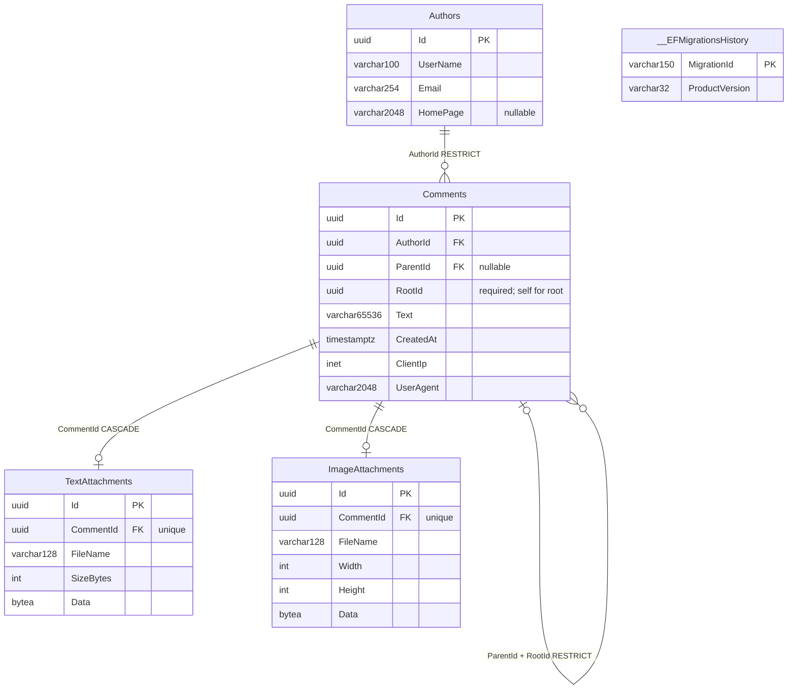
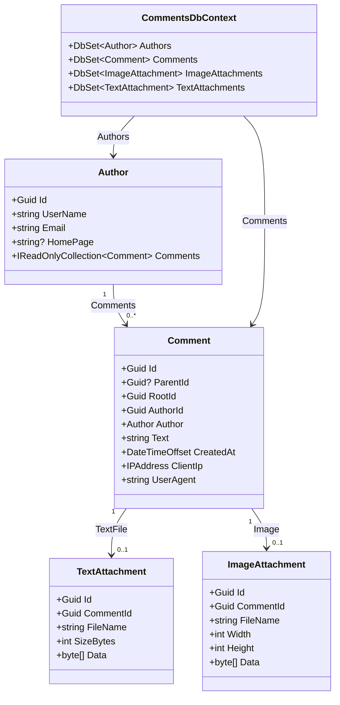

# Database schema / Схема БД / Схема БД — 1.1.1.16

## English

Native [commentsservice.mwb](commentsservice.mwb) and [diagram preview](workbench-schema.png) are available. Real Workbench8.0.47 imported/saved/reopened the model:5tables/25columns/12indexes/5PK/4FK; live catalog parity passed. Manual menu clicks were not performed, and the Windows process reported a shutdown exit anomaly. [Verification and generation](WORKBENCH.md). Schema/migrations are unchanged; older acceptance wording below is historical.

The application is 1.1.0.15; the schema remains migration 20261030130243_TextAttachments. The authoritative model is EF Core in Infrastructure/Persistence; [postgresql.sql](postgresql.sql) is the idempotent export. All four migration IDs are listed in [MIGRATIONS.md](MIGRATIONS.md). All application tables/history are in schema `comments`.

The catalog contains 5 tables, 25 columns, 12 indexes, 4 foreign keys and 6 checks. Authors captures submitted identity (not authentication); e-mail is public and not unique. Comments stores text, UTC creation time, server-derived inet IP/UserAgent and immutable parent/root references. The composite parent/root FK rejects a different root; author/parent deletion is restricted. ImageAttachments and TextAttachments each have a unique CommentId and cascade only with their owner. Domain/Application enforce one image OR TXT; bytes are in PostgreSQL bytea and its backups. Original fields/IDs survive additive upgrades.

Bounds: username 100 Latin letters/digits, e-mail 254, homepage 2048, text 65536, UserAgent 2048; image dimensions 1..320/1..240 and bytes 1..524288; TXT 1..102400 bytes with matching SizeBytes. Syntax/codec/UTF-8 checks live in application/infrastructure ports, not solely in SQL. See [API](../API.md) and [architecture](../ARCHITECTURE.md).

[workbench.sql](workbench.sql) is a MySQL visualization projection only. UUID maps to CHAR(36), inet to VARCHAR(45), UTC timestamptz to DATETIME(6), bytea to MEDIUMBLOB, VARCHAR(65536) to annotated MEDIUMTEXT. PostgreSQL check definitions remain authoritative in the export. Use File → Import → Reverse Engineer MySQL Create Script, UTF-8, and diagram placement; save a `.mwb` after import. Do not deploy this projection to PostgreSQL. Automated catalog parity passed for columns/types/nullability/index uniqueness/order/FKs/delete rules; GUI import was not verified. See [acceptance](../ACCEPTANCE.md).

## Русский

Добавлены [commentsservice.mwb](commentsservice.mwb) и [превью](workbench-schema.png). Настоящий Workbench8.0.47 импортировал/сохранил/повторно открыл модель:5таблиц/25колонок/12индексов/5PK/4FK; паритет живого каталога прошёл. Ручных кликов меню не было, процесс Windows сообщил аномальный код завершения. [Проверка и генерация](WORKBENCH.md). Схема/миграции прежние; нижние формулировки прежней приёмки исторические.

Приложение имеет версию 1.1.0.15; схема остаётся на миграции 20261030130243_TextAttachments. Эталонная модель EF Core — Infrastructure/Persistence; [postgresql.sql](postgresql.sql) — идемпотентный экспорт. Четыре ID миграций перечислены в [MIGRATIONS.md](MIGRATIONS.md). Таблицы/история находятся в схеме `comments`.

Каталог содержит 5 таблиц, 25 колонок, 12 индексов, 4 внешних ключа и 6 checks. Authors хранит введённую личность, не аутентификацию; e-mail публичен и не уникален. Comments хранит текст, время UTC, серверные inet IP/UserAgent и неизменяемые ссылки родителя/корня. Составной FK запрещает другой корень родителя; удаление автора/родителя ограничено. ImageAttachments и TextAttachments имеют уникальный CommentId и каскад только с владельцем. Domain/Application обеспечивают одно изображение ИЛИ TXT; байты лежат в PostgreSQL bytea и backup. Прежние поля/ID сохраняются при расширении схемы.

Пределы: имя 100 латинских букв/цифр, e-mail 254, сайт 2048, текст 65536, UserAgent 2048; размеры картинки 1..320/1..240 и байты 1..524288; TXT 1..102400 байт с совпадающим SizeBytes. Синтаксис/кодек/UTF-8 проверяются через порты приложения/инфраструктуры, не только SQL. См. [API](../API.md) и [архитектуру](../ARCHITECTURE.md).

[workbench.sql](workbench.sql) — только MySQL-проекция для визуализации. UUID отображается в CHAR(36), inet — VARCHAR(45), UTC timestamptz — DATETIME(6), bytea — MEDIUMBLOB, VARCHAR(65536) — MEDIUMTEXT с пояснением. Проверки PostgreSQL остаются эталонными в экспорте. Импорт: File → Import → Reverse Engineer MySQL Create Script, UTF-8, размещение на диаграмме; затем сохранить `.mwb`. Не развёртывайте проекцию в PostgreSQL. Автоматически совпали колонки/типы/NULL/уникальность и порядок индексов/FK/правила удаления; GUI-импорт не подтверждён. См. [приёмку](../ACCEPTANCE.md).

## Українська

Додано [commentsservice.mwb](commentsservice.mwb) і [прев'ю](workbench-schema.png). Справжній Workbench8.0.47 імпортував/зберіг/повторно відкрив модель:5таблиць/25колонок/12індексів/5PK/4FK; паритет живого каталогу пройшов. Ручних кліків меню не було, процес Windows повідомив аномальний код завершення. [Перевірка й генерація](WORKBENCH.md). Схема/міграції попередні; нижні формулювання попереднього приймання історичні.

Застосунок має версію 1.1.0.15; схема залишається на міграції 20261030130243_TextAttachments. Еталонна модель EF Core — Infrastructure/Persistence; [postgresql.sql](postgresql.sql) — ідемпотентний експорт. Чотири ID міграцій наведено в [MIGRATIONS.md](MIGRATIONS.md). Таблиці/історія розміщені у схемі `comments`.

Каталог містить 5 таблиць, 25 колонок, 12 індексів, 4 зовнішні ключі та 6 checks. Authors зберігає введену особу, не автентифікацію; e-mail публічний і не унікальний. Comments зберігає текст, час UTC, серверні inet IP/UserAgent та незмінні посилання батька/кореня. Складений FK забороняє інший корінь батька; видалення автора/батька обмежено. ImageAttachments і TextAttachments мають унікальний CommentId та каскад лише з власником. Domain/Application забезпечують одне зображення АБО TXT; байти лежать у PostgreSQL bytea та backup. Попередні поля/ID зберігаються під час розширення схеми.

Межі: ім’я 100 латинських літер/цифр, e-mail 254, сайт 2048, текст 65536, UserAgent 2048; розміри зображення 1..320/1..240 і байти 1..524288; TXT 1..102400 байтів із відповідним SizeBytes. Синтаксис/кодек/UTF-8 перевіряються через порти застосунку/інфраструктури, не лише SQL. Див. [API](../API.md) та [архітектуру](../ARCHITECTURE.md).

[workbench.sql](workbench.sql) — лише MySQL-проєкція для візуалізації. UUID відображається в CHAR(36), inet — VARCHAR(45), UTC timestamptz — DATETIME(6), bytea — MEDIUMBLOB, VARCHAR(65536) — MEDIUMTEXT із поясненням. Перевірки PostgreSQL залишаються еталонними в експорті. Імпорт: File → Import → Reverse Engineer MySQL Create Script, UTF-8, розміщення на діаграмі; потім зберегти `.mwb`. Не розгортайте проєкцію в PostgreSQL. Автоматично збіглися колонки/типи/NULL/унікальність і порядок індексів/FK/правила видалення; GUI-імпорт не підтверджено. Див. [приймання](../ACCEPTANCE.md).

## ER / БД / БД

## OOP / ООП / ООП

